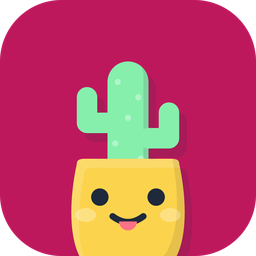
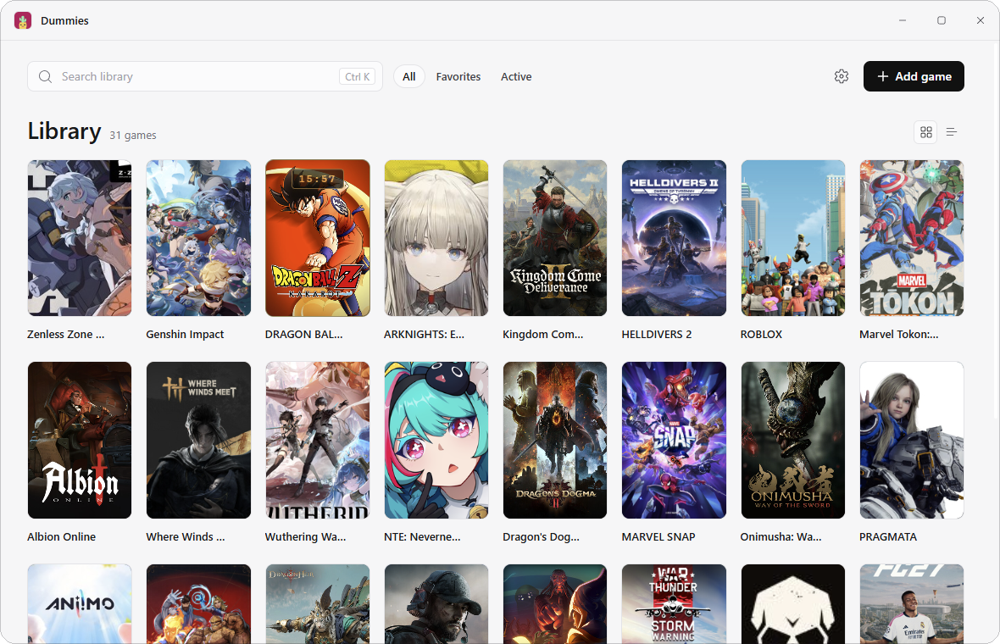
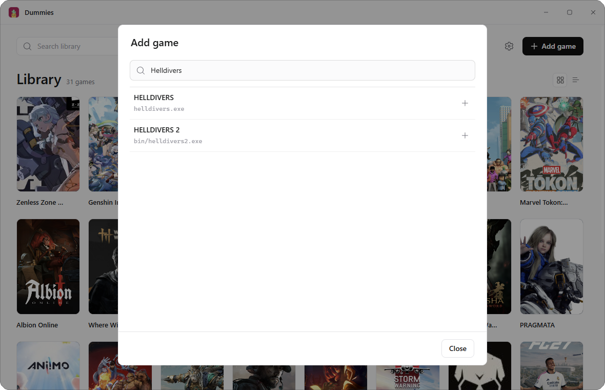
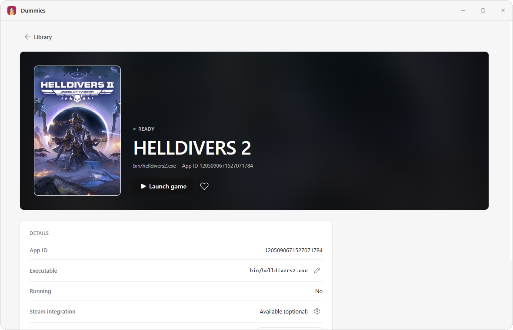
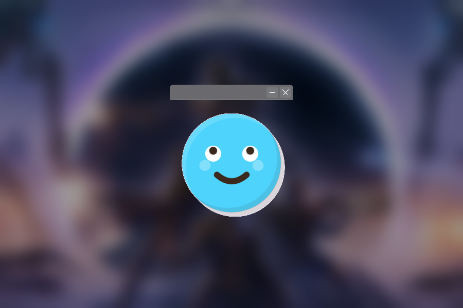
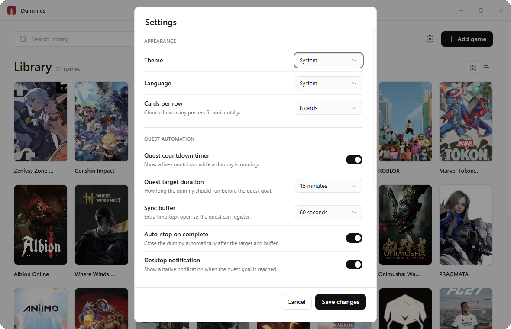

<p align="center">
  
</p>

<h1 align="center">Dummies</h1>

<p align="center">
  <strong>Keep your Discord game status online — without keeping the game open.</strong><br>
  A lightweight Windows launcher for your game library and game presence.
</p>

<p align="center">
  <a href="https://github.com/Morphy137/dummies-launcher/releases/latest">
    
  </a>
  
  
  
</p>

<p align="center">
  
</p>

<p align="center">
  <em>Your library, your favorites and your active games in one place.</em>
</p>

## What Dummies does

Dummies is a small Windows app that makes Discord show the game you choose. Add a
game, press **Play**, and Dummies opens a tiny transparent window that Discord
recognizes. Stop it whenever you want.

- No Discord login or account connection.
- No game installation required.
- Covers, favorites and filters stay ready between sessions.
- Automatic updates from version 1.0.2 onward.
- Runs on Windows 10 and 11.

## Add any detectable game

Search the built-in catalog of games Discord can detect and add one in a click. Dummies
keeps your library on your PC and caches cover art, so switching filters is instant.

<p align="center">
  
</p>

## Open a game and press Play

Each game has a detail view with its cover, executable, App ID and Steam status. Launch
or stop the dummy from here, edit the executable, create a shortcut or configure Steam.

<p align="center">
  
</p>

## A tiny window, not another game

The dummy is a transparent, animated face with minimize and close controls. It is
resizable, stays out of the way and can be sent to the tray. Discord still sees the game
while it is running.

<p align="center">
  
</p>

## Make it yours

Choose the theme, language and cards per row. Configure quest timers, sync buffer,
auto-stop, desktop notifications and floating-window behavior from one settings panel.

<p align="center">
  
</p>

## How it works

1. **Download** Dummies for Windows.
2. **Add a game** from the built-in catalog.
3. **Press Play**. Discord shows the game while Dummies is running.
4. **Press Stop** when you are done.

## Download

Get the latest installer or portable ZIP from the
[releases page](https://github.com/Morphy137/dummies-launcher/releases/latest).

| Package | Use it if… |
|---|---|
| **Installer** | You want a normal Windows installation with a Start menu shortcut. |
| **Portable ZIP** | You prefer to run Dummies without installing it. |

The installer is not code-signed yet, so Windows SmartScreen may ask you to confirm the
first launch.

## Built for Windows

Dummies uses the Discord-detectable app catalog, keeps its data local and supports
English and Spanish. Game covers come from Steam and Discord. Your game installation
and account are not modified.

Dummies is an independent project and is not affiliated with Discord.

## Development

<details>
<summary>Build and run from source</summary>

**Requirements:** Windows 10/11, Rust MSVC, Node.js, pnpm and the WebView2 runtime.

```powershell
pnpm install
pnpm build:dummy
pnpm tauri:dev
```

**Build the Windows installer:**

```powershell
pnpm tauri build --bundles nsis
```

**Build the portable ZIP:**

```powershell
pnpm tauri build --no-bundle
pnpm package:portable
```

**Checks:**

```powershell
pnpm check
pnpm test
cargo test --manifest-path src-tauri/Cargo.toml
cargo test --manifest-path crates/dummy-game/Cargo.toml
```

More details:

- [`docs/ARCHITECTURE.md`](docs/ARCHITECTURE.md) — stack, data, dummy process and release flow.
- [`docs/DESIGN.md`](docs/DESIGN.md) — visual system, screens and motion.

</details>

## License

MIT. See [`LICENSE`](LICENSE) and [`THIRD_PARTY_NOTICES.md`](THIRD_PARTY_NOTICES.md).
